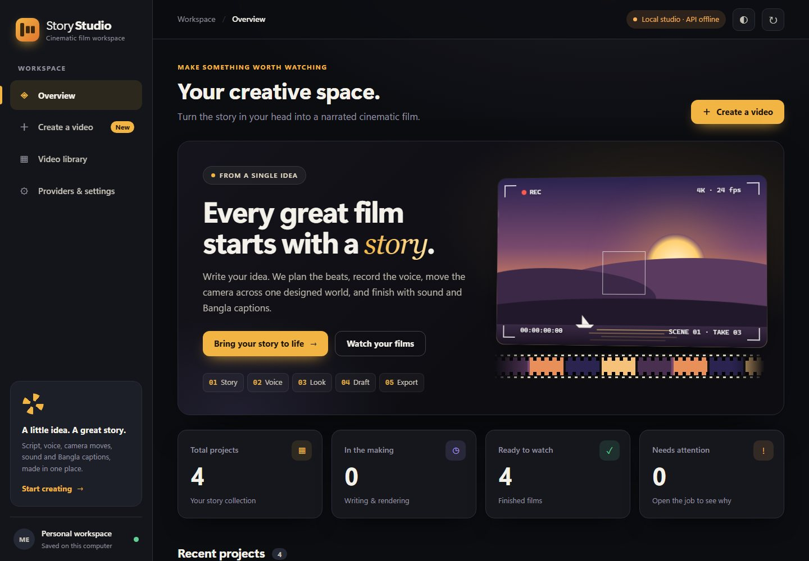
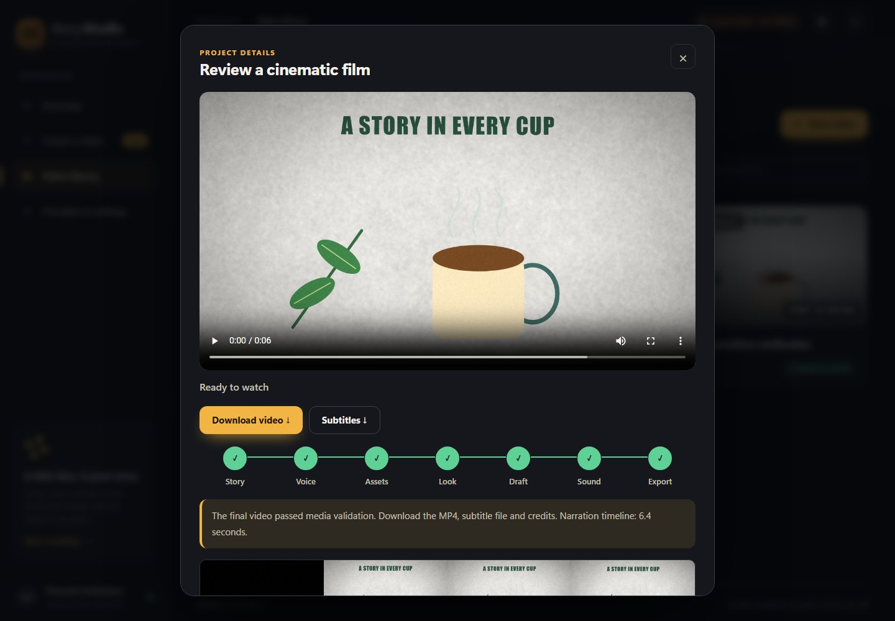
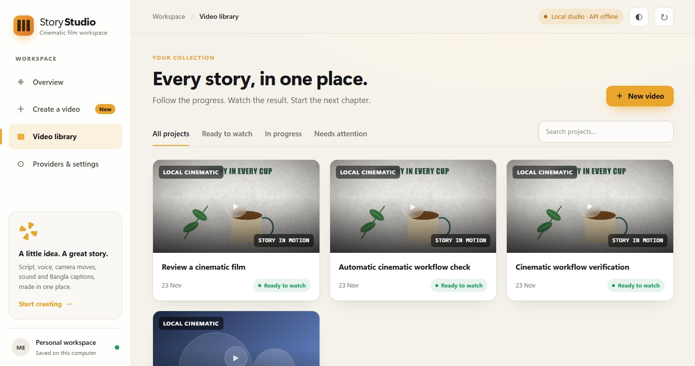
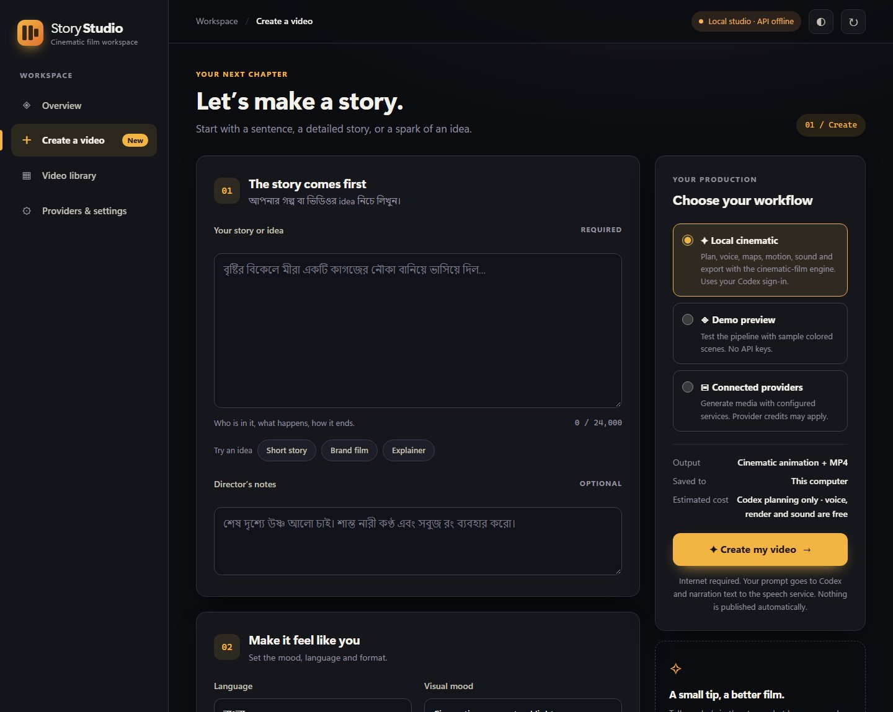

<h1 align="center">Story Video Automation</h1>

<p align="center"><b>Turn a story into a narrated cinematic film, with voice and captions in 38 languages.</b><br>
Write an idea, approve the script, the look and a draft, and download the MP4, subtitles and credits.</p>

<p align="center">
  
  
  
  
  
</p>

<p align="center"></p>

## What it does

- **Local cinematic films for free.** The bundled cinematic-film engine draws every frame in code:
  one continuous camera over a designed world, stamps, counters, maps and photos timed to the narration.
  Voice (Edge TTS), sound effects, mixing, rendering and captions all run on your computer.
- **You approve each step.** Script and beat table, then preview frames and contact sheets, then a
  30-second draft, then the final export. Automatic checks flag script, look and voice problems first.
- **Any AI, per video.** Pick Gemini, OpenAI or Claude for the story, or Auto for the cheapest connected
  one; Muse or Runway for generated clips; OpenAI or Vertex for images; OpenAI or ElevenLabs for voice.
- **Low AI spend.** Story plans and clips are cached per scene, so edits only pay for what changed,
  and the dashboard shows the estimated cost before you queue.

<table>
  <tr>
    <td width="50%"></td>
    <td width="50%"></td>
  </tr>
  <tr>
    <td><sub>Review a film: watch it, download MP4 and subtitles, and follow all seven stages.</sub></td>
    <td><sub>Your library in light mode, each card showing a frame from its own film.</sub></td>
  </tr>
</table>

## Quick start (Windows)

```bat
python -m pip install -r requirements.txt
studio.cmd
```

The dashboard opens in your browser. Choose **Create a video**, write your story (Bangla or English),
pick a film look, and press **Create my video**. Local cinematic mode needs FFmpeg on PATH and a
signed-in Codex CLI for planning; provider mode needs the API keys listed in `.env.example`.

## Any language

Pick the language on the Create page and the voice list switches to that language. The planner
writes the narration, captions and on-screen words in it, and every script renders correctly:

| Region | Languages |
| --- | --- |
| South Asia | Bangla, Hindi, Urdu, Tamil, Telugu, Marathi, Gujarati, Malayalam, Kannada, Nepali, Sinhala, Pashto, English (India) |
| East and Southeast Asia | Chinese (Mandarin, Taiwan), Japanese, Korean, Thai, Vietnamese, Indonesian, Malay, Filipino |
| Middle East and Africa | Arabic (Saudi, Egypt), Persian, Turkish, Swahili |
| Europe and the Americas | English (US, UK), Spanish (Spain, Mexico), Portuguese (Brazil), French, German, Italian, Russian |

- **On-screen text** is shaped with HarfBuzz in a font for its script: joined Devanagari and Bengali,
  right-to-left Urdu and Arabic, Chinese, Japanese and Korean in their own fonts.
- **Captions** pick their font from the text (Nirmala UI, Segoe UI, Microsoft YaHei, Yu Gothic,
  Malgun Gothic, Leelawadee UI…) and long Chinese or Japanese lines wrap evenly.
- **Timing** counts a Chinese character as a syllable, so script-length checks hold in every language.
- Narration uses free Edge TTS voices (two or more per language); Punjabi has no Edge voice yet.
  You can also record your own takes in any language.

Films are saved as `out/final-video.mp4` with `out/captions.srt` (older projects keep their names).

## How a film is made

| Step | What happens | You |
| --- | --- | --- |
| 1. Story | The planner writes `script.json` and `scene.py`, then fixes the beat-table lint | Approve the script |
| 2. Voice | Bangla or English narration, timed line by line | — |
| 3. Assets | Photos with licences, maps, fonts and prepared images | — |
| 4. Look | Preview stills and a contact sheet per camera move, checked automatically | Approve the look |
| 5. Draft | A 30-second 720p draft with the voice | Approve the draft |
| 6. Sound | Synthesised effects, optional score, loudness-normalised mix | — |
| 7. Export | Full render, burned-in captions, SRT, credits and a playback check | Download |

<p align="center"></p>

## Project rules

Python for the backend and rendering; plain Node.js for the dashboard. Do not add Next.js or another
frontend framework. Keep every Python dependency in the single root `requirements.txt`; do not create
separate local, dev or distributed requirements files. Avoid redundant setup files and dependencies.
Node.js has no npm package dependencies. FFmpeg and FFprobe remain system tools.

## Cinematic-film backend

The dashboard's local workflow is driven by `backend/cinematic.py`, using the
bundled cinematic-film scripts directly. The coding agent prepares the story and
scene plan; Python owns voice, assets, preview, render, sound and final validation.
`studio.cmd`, `VIDEO-MAKER.cmd` and `Video-Maker.py` all open this same dashboard.

Create a video in **Local cinematic** mode. By default the workflow pauses for:

1. Script and beat-table approval.
2. Look approval after preview frames and a camera contact sheet.
3. Draft approval before sound mixing and the complete final export.

Uncheck the review option to run an approved plan automatically through all stages.
Each stage saves status, outputs, logs and errors in the project folder. A failed
stage can be retried, and changed plan files invalidate prior approval. Revision
notes regenerate the plan; **Recheck files I edited** validates manual script changes.

Features exposed in the dashboard:

- Seven cinematic looks: studio, wall, slate, charcoal, blueprint, paper and night.
- The original camera/spotlight, photos, document, card, counter, stamp, pen, route and map engine.
- Licensed Commons photos and credits; map/region/route generation when selected.
- Online Bangla/English narration, recorded takes, or recorded per-line WAV files.
- Preview stills, contact sheets, up-to-30-second draft and full MP4 export.
- Synthesized effects, normalized voice/effects mixing, optional licensed background score.
- Four shaped caption treatments, UTF-8 SRT, beat table, credits and media verification report.
- Landscape/portrait drafts and exports through 4K, rendered in parallel on as many workers as fit in memory (`RENDER_WORKERS` in `.env` sets a fixed number). Higher resolutions require more time and memory.

Use **Open project folder** to add assets, recordings or `audio/music.mp3` before
continuing. Recorded takes use the take names in `script.json`; recorded lines use
`audio/lines/segNN.wav`. Background score mixing currently requires narration enabled.
The selected speech service receives narration text. Story/scene planning requires
Codex CLI login. Nothing is uploaded or published automatically.

The workflow follows the skill's checks automatically:

- `check_setup.py` runs first, before any Codex planning is spent, and names what is missing.
- The planner runs the beat-table lint itself and fixes its warnings; any that remain appear
  in the review window with a **Fix these with Codex** button.
- `tools/review_look.py` renders one contact sheet per camera move (found with the engine's own
  speed test) and flags spotlight drift, dark frames and empty frames before you approve the look.
- Drafts render at 1280x720 (720x1280 portrait), as the skill specifies, or at the final size when that is smaller; the final uses your size.
- Recorded takes surface `split_takes.py`'s suspect-cut flags for listening.
- A failed stage shows the last lines of its own output instead of a bare exit code.

Windows fixes include explicit UTF-8 text reads, Unicode-aware word timing shares,
bounded encoder threads and a portable sound filter. Word timing is approximate
letter-share timing, as in the source engine; it is not forced audio alignment.
`split_takes.py` and `captions.py` count letters in any script, so Bangla recorded
takes are timed and flagged correctly (they previously counted only A–Z).

## Connect your AI accounts

Open **Providers & settings** in the dashboard. Every AI the studio can use has a card; press **Connect**.

- **Paste a key** (OpenAI, Claude, Runway, Muse, ElevenLabs): the dialog links to the page where you sign in and make a key. The key is tested with one free, read-only request before it is saved to `.env`, and the page only ever shows its last four characters.
- **Sign in with Google**: Gemini opens Google AI Studio, where your Google account makes a key. Google Vertex AI uses a real Google sign-in through the free [Google Cloud CLI](https://cloud.google.com/sdk/docs/install), so you never paste access tokens that expire every hour.
- **Claude**: a Claude.ai Pro or Max sign-in cannot be used by other apps. Make an API key in the [Claude Console](https://console.anthropic.com/settings/keys); it is billed per use, separately from a Claude.ai subscription.
- **Codex** signs in with your ChatGPT account inside the Codex app, and **Edge voices** are free with nothing to connect.

New keys apply to the next video without restarting the studio.

## Choosing the story AI

In **Connected providers** mode, pick the **Story AI** for each video on the Create page:

| Choice | Uses | Key in `.env` | Model setting (default) |
| --- | --- | --- | --- |
| Auto | The cheapest connected AI; if it fails, the next one | any of the keys below | — |
| Gemini | Gemini's OpenAI-compatible API | `GEMINI_API_KEY` | `GEMINI_STORY_MODEL` (gemini-2.5-flash) |
| OpenAI | OpenAI Responses API | `OPENAI_API_KEY` | `OPENAI_MODEL` (gpt-5-mini) |
| Claude | Anthropic SDK, structured output, refusal fallback | `ANTHROPIC_API_KEY` | `CLAUDE_STORY_MODEL` (claude-opus-5-5), `CLAUDE_STORY_EFFORT` (medium) |

The list shows which AIs have a key (never the key) and remembers your last choice. Each video
saves the AI it used in its log, and every plan is cached, so re-running the same brief is free.
A `STORY_PROVIDER_CONFIG` routing file still applies when the choice is left on **Auto**.
Video clips (Muse, Runway), images and voice are still chosen on **Providers & settings**.

## Keeping AI costs low

Local cinematic mode is the cheapest route: voice (Edge TTS), rendering, sound and captions
run on this computer; only Codex planning uses your quota. Set `CODEX_MODEL` or
`CODEX_REASONING_EFFORT` in `.env` to plan with less, and revisions edit only what changed.

Provider mode spends credits, so every paid step avoids repeat or wasted work:

| Step | Control |
| --- | --- |
| Story (OpenAI) | Low reasoning effort for GPT-5/o-series, an output cap, and a plan cache: re-drafting an identical brief is free (`STORY_CACHE=0` to disable). |
| Story (routing) | `input/story-providers.example.json` uses `lowest_cost`: Gemini 2.5 Flash first, then GPT-5-mini, under `max_estimated_usd`. |
| Video (Muse, Runway) | Each scene has its own cache, so editing one scene pays for that scene only; a moved scene reuses its clip. Default source is 720p (about half of 1080p's credits) with local Lanczos upscaling to the export size. The dashboard shows the estimate before you queue. |
| Images (GPT Image) | `IMAGE_QUALITY` defaults to `medium`; `auto` can choose the far costlier `high`. |
| Voice (OpenAI, ElevenLabs) | Dialogue that cannot fit its scene is refused before the request, so nothing is charged; the story prompt asks for dialogue that fits. Narration stays cached by text. |

All Python dependencies stay in the one root `requirements.txt`. The existing
installer can make `.venv`; this PC can also use its previously tested runtime.
FFmpeg and FFprobe are required system tools. The bundled source is MIT licensed;
see `skills/CINEMATIC-LICENSE`.

## Start the dashboard on Windows

With Python 3.12+ and Node.js installed, run:

```powershell
.\studio.cmd
```

The launcher starts the native Node.js dashboard, FastAPI, and the render worker.
Your browser opens automatically; no dashboard token needs to be copied.
If a preferred port is unavailable, the launcher uses an available port.
You can also run `npm start`. Node.js 22+ is required; there are no npm runtime dependencies
and no frontend build step. Keep Python render dependencies installed.
Keep the terminal open while using the dashboard. Press Ctrl+C to stop it.

An empty or missing .env is sufficient for demo jobs. Add real credentials to
.env when available and restart the studio. Install FFmpeg with libass if it
is not already available. Open the dashboard through the printed URL.

## Run the demo

Open PowerShell in the project folder and run:

```powershell
.\run.cmd draft --demo
.\run.cmd render RUN_NAME
```

Replace `RUN_NAME` with the name printed by the first command. Open `runs/RUN_NAME/preview.mp4` to see a sample with colored frames and Bengali captions.

## Use your own story and make last-minute changes

1. Enter your story or idea in `story` in `input/brief.json`. Put last-minute instructions in `final_changes`. Use the same file to adjust the language, visual style, duration, audio, and captions. The default output is vertical 1080p.
2. Copy `.env.example` to `.env`. Set your OpenAI API key and a Responses API model available to your account, or configure the [multi-provider story router](documentation/implementation.md). FFmpeg and FFprobe must be available through PATH, `FFMPEG_PATH`, or an FFmpeg build unzipped into `tools/ffmpeg` (`winget install Gyan.FFmpeg` installs one). Burning captions requires FFmpeg with libass.
3. Run `.\run.cmd draft` and review `runs/RUN_NAME/plan.json`. Edit scenes, dialogue, captions, or post copy directly in the plan. To regenerate the story with new instructions, edit the brief and run `draft` again.
4. Run `.\run.cmd render RUN_NAME`. If your video service is **muse-video.com**, set `MUSE_PROVIDER=muse-video.com` and `MUSE_API_KEY`. Other Muse services require their own adapter. Regenerating edited scenes may use credits. To supply your own MP4, run `.\run.cmd render RUN_NAME --video "D:\my-video.mp4"`.
5. Review the visuals, audio, and pronunciation in `preview.mp4`. Set `made_for_kids` and `synthetic_disclosure` according to your content before uploading.

## Export resolution

`resolution` sets the Muse source to 720p or 1080p. `export_resolution` selects 720p (720×1280), 1080p (1080×1920), 1440p (1440×2560), or 4K (2160×3840). FFmpeg uses Lanczos scaling when the export exceeds the source resolution. Changing only the export resolution reuses the cached Muse clips for that run. An MP4 supplied with `--video` retains its original resolution.

## Upload and automate

For YouTube, configure a Google OAuth client with YouTube Data API enabled and a refresh token authorized for `youtube.upload`. For Facebook, set the Page ID, Page access token, and Graph API version. Keep credentials in the local `.env` file.

```powershell
.\run.cmd upload RUN_NAME --platform both
.\run.cmd upload RUN_NAME --platform both --public
.\run.cmd auto --platform both --public
```

The first command submits the video as private on YouTube and as a draft on Facebook. The second requests public publication. The third uses the current story and final instructions to generate, render, and submit the video in one run. To review the preview before uploading, use the separate `draft`, `render`, and `upload` commands.

Successful submissions are recorded per run and platform. Use YouTube Studio or Meta Business Suite to publish an existing private video or draft. If the connection drops during an upload, check the platform for the result before resubmitting. If Muse is still processing a scene, rerun `render` with the same run name to resume polling.

## Local dashboard and worker

Install Python 3.12+, FFmpeg, and the Python dependencies. From the project root, set a private admin token of at least 24 characters in the API terminal and start the server:

```powershell
python -m pip install -r requirements.txt
$env:STUDIO_ADMIN_TOKEN = 'replace-with-a-long-random-token'
python -m uvicorn backend.api:app --host 127.0.0.1 --port 8765
```

In a second terminal, start the worker from the same folder:

```powershell
python -m backend.worker
```

Open `http://127.0.0.1:8765`, enter the admin token, and queue a demo or a real render. Pending jobs persist in the local SQLite database. If a worker stops during a paid render or an upload, inspect the provider or platform and the run receipts before resubmitting. See the [implementation checklist](documentation/implementation.md) for distributed deployment work.

- [OpenAI Responses API](https://developers.openai.com/api/reference/resources/responses/methods/create)
- [Muse Video API](https://muse-video.com/docs/api)
- [YouTube Data API](https://developers.google.com/youtube/data/reference/rest/v3/videos/insert)
- [Facebook Reels API](https://www.postman.com/meta/facebook/request/juhnm3q/4-publish-reel)

## Configure live APIs later

The demo runs without API keys. When you have your accounts, copy the
environment template and edit the local file:

```powershell
Copy-Item .env.example .env
.\run.cmd check --platform both
```

Set the story credentials (or story router), then choose a video provider
or illustrated mode. Voice credentials are needed only if you enable TTS.
Supply the publishing credentials for the selected platforms. To prepare
one platform first, pass youtube or facebook to the check command.

The check validates local settings and FFmpeg without sending requests,
spending credits, or uploading videos. A successful check does not verify
token validity or platform permissions. For a live trial, render and review
the preview, then use the upload command without --public to submit privately
to YouTube or as a Facebook draft.

## Dashboard and distributed deployment

The Node.js dashboard supports job submission, previews, provider defaults,
scheduled deliveries, and on-demand engagement. PostgreSQL and Redis/Celery
are available through the distributed Compose configuration. See
[deployment instructions](documentation/deployment.md) for setup and acceptance checks.

## Redesigned Node.js dashboard

- Overview: project counts, recent films and story starters.
- Create a video: story prompt, director notes, mood, frame and output controls.
- Local cinematic mode: uses the signed-in Codex CLI and existing Bangla helpers.
- Demo mode: tests the render pipeline without provider credentials.
- Connected-provider mode: existing API generation, previews and approved publishing.
- Video library: search, status filters, playable previews, downloads and production logs.
- Provider settings: saved defaults, account checks, usage and cost reports.

Run `studio.cmd` or `npm start`. The dashboard binds to loopback and uses an
HttpOnly local session; backend credentials remain on the server. The original
Python CLI and distributed backend remain available.
The dashboard uses native Node.js modules and static HTML/CSS/JavaScript.
Obsolete framework build files and unused npm packages have been removed.

Validation: `npm test`, `npm run check`, and `python -m pytest tests -q`.
Browser verification included a completed demo submission and a playable preview.
Live paid generation, Codex story generation and publishing were not triggered
as part of the dashboard migration.

Backend workflow validation: approval/retry/changed-plan tests, Bangla timing tests,
Node stage/artifact API tests, a recorded-voice review sample, and an automatic
sample using live online voice, synthesized cues, loudness mixing and captioned
MP4 verification. Story planning for these samples used existing plan files; a new
Codex-generated story, archive/map downloads and live publishing were not exercised.
