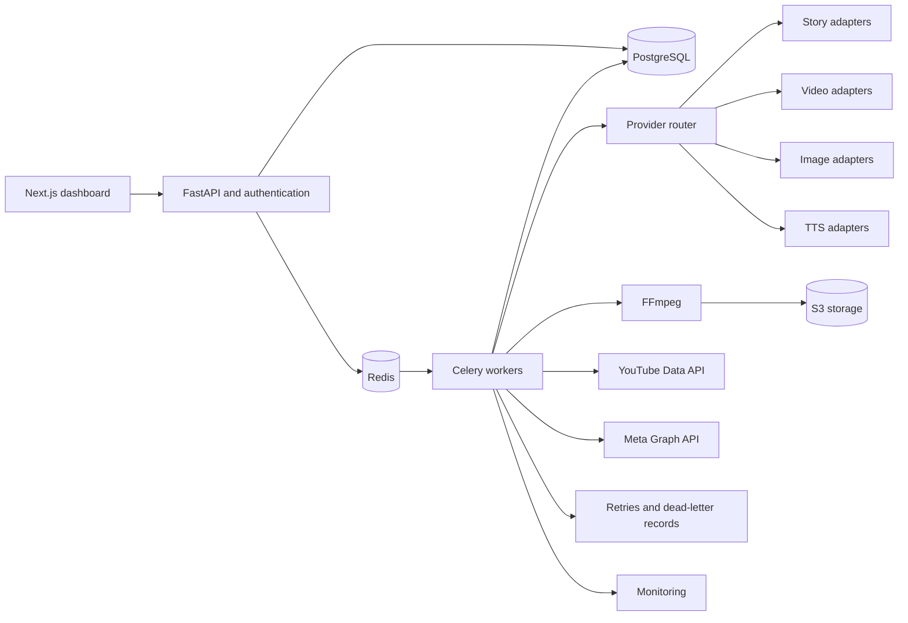
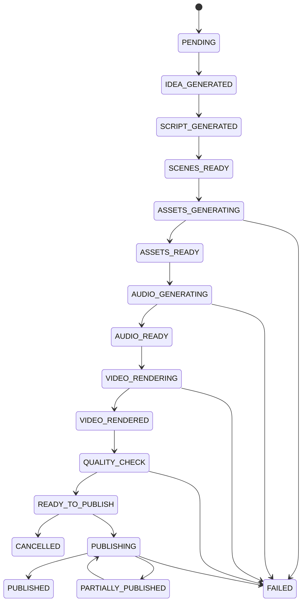

# Platform implementation checklist

- [x] Preserve existing local demo, render and publishing CLI.
- [x] Story routing from config, strict scene schema, environment keys, estimated request budget and fallback tests.
- [x] Local FastAPI dashboard, SQLite job queue, separate worker and preview.
- [x] Independent approval-based delivery queues, with partial failure tests.
- [x] Video and voice provider selection with explicit rate-limit fallback.
- [x] OpenAI illustrated video mode.
- [x] Local studio provider defaults and scheduled delivery.
- [x] Single-host container configuration (container execution pending).
- [ ] Additional image providers and centralized multi-category routing.
- [ ] Add PostgreSQL schema, encrypted credential management, API authentication and provider settings.
- [x] Redis/Celery dispatch and PostgreSQL queue implementation, pending infrastructure acceptance.
- [x] Optional S3 preview archiving and worker heartbeat endpoint.
- [ ] Full workflow reconciliation, S3-backed media serving, and production alerting.
- [x] Next.js dashboard, provider defaults, preview and approval-based delivery.
- [ ] Production monitoring and full provider administration.
- [ ] Extend media production and official social integrations.
- [ ] Run infrastructure, live provider and publishing acceptance tests.

## Target architecture

## Target state transitions

## Story provider setup

Install requirements, copy input/story-providers.example.json to input/story-providers.json,
and set STORY_PROVIDER_CONFIG=input/story-providers.json in the local .env. Keep keys in
server-side environment variables. Only configure endpoints you trust with submitted stories.
Enter actual model IDs and conservative estimated per-request costs for your account. The cap
applies to one story invocation and includes attempted calls. It is not a vendor billing ledger.

The current router supports Chat Completions endpoints with JSON object mode, including
compatible model configurations for OpenAI, Gemini, DeepSeek and custom gateways.
Check protocol and model support before enabling an endpoint.

- [OpenAI Chat Completions](https://developers.openai.com/api/reference/resources/chat/subresources/completions/methods/create)
- [Gemini OpenAI compatibility](https://ai.google.dev/gemini-api/docs/openai)
- [DeepSeek JSON output](https://api-docs.deepseek.com/guides/json_mode)

## Video provider selection

Set VIDEO_PROVIDER to muse-video.com or runway. The old MUSE_PROVIDER setting
continues to work as a default. Runway uses Gen-4.5 with a 720p vertical source,
audio disabled, and 4–10 second scenes in the current brief schema. Set
RUNWAY_API_KEY in the local environment. Export resolution remains independent.
A paid Runway submission is journaled before the request. A known task ID can
be polled again. A submission with an unknown outcome requires reconciliation.

- [Runway API reference](https://docs.dev.runwayml.com/api/)

## Optional scene narration

Set TTS_PROVIDER to openai or elevenlabs. Set TTS_MODEL and TTS_VOICE to a
model and voice available to your account. Set OPENAI_API_KEY for OpenAI,
or ELEVENLABS_API_KEY for ElevenLabs. Keep these settings in the local .env.

The renderer uses each scene's dialogue as narration and requests silent
source clips. It normalizes and caches the narration. Short narration is
padded to the scene length. If narration exceeds the scene length, shorten
the dialogue or extend the scene before trying again. Check the selected
model's language support and review pronunciation in the preview.

- [OpenAI speech API](https://developers.openai.com/api/reference/resources/audio/subresources/speech/methods/create)
- [ElevenLabs speech API](https://elevenlabs.io/docs/api-reference/text-to-speech/convert)

Set VIDEO_FALLBACK_PROVIDER to a different configured video provider to opt
into fallback after an explicit HTTP 429 rejection at submission. Both
providers must support the requested source format, audio and duration.
The chosen provider is recorded per scene. Polling and ambiguous submission
failures remain with the original provider for reconciliation.

## Voice fallback and local scheduling

Set TTS_FALLBACK_PROVIDER, TTS_FALLBACK_MODEL and TTS_FALLBACK_VOICE to opt
into the other supported voice provider after an explicit HTTP 429 response.
The fallback selection is persisted without credentials. Verify that both
selected voices support the story language and fit the scene timing.

The local dashboard accepts an optional publish time and sends it to the API
as UTC. The worker submits due uploads while it is running. Platform
processing can delay publication. The summary reports local job and
delivery counts. Platform views and engagement require separate analytics.

## Studio provider defaults

Use Provider defaults in the local dashboard to set video, video backup,
voice provider, and a per-job estimated story budget. Explicit dashboard
values are captured at enqueue time. Unset values use the worker's current
environment. Configure a story router before setting a budget; the lower of
the router cap and dashboard cap applies. Voice models and credentials
remain in the worker's configuration.

## Illustrated video mode

Set IMAGE_PROVIDER=openai and IMAGE_MODEL to a GPT Image model available
to your account, with OPENAI_API_KEY set in the local environment. This mode
renders scene illustrations as still clips with captions and optional TTS.
The dashboard can select illustrated mode for new jobs. Generated PNGs are
cached by prompt, model, and format within the render asset directory.
A submission whose outcome is unknown requires manual reconciliation.

- [OpenAI Images API](https://developers.openai.com/api/reference/resources/images/methods/generate)

## Video engagement

Use the metrics button for a submitted dashboard delivery, or run
run.cmd analytics RUN_NAME --platform youtube (or facebook).
The YouTube adapter reads lifetime views, likes and comments from the
video statistics resource. The Facebook adapter reads the likes and
comments summaries when available for that video. These are on-demand
snapshots; missing fields are omitted. Use a token authorized to read
the target video, in addition to any permissions needed to publish.

- [YouTube video statistics](https://developers.google.com/youtube/data/reference/rest/v3/videos)
- [Facebook object likes](https://developers.facebook.com/docs/graph-api/reference/object/likes)
- [Facebook object comments](https://developers.facebook.com/docs/graph-api/reference/object/comments)

### Dashboard story routes

Set STUDIO_LLM_URL_PRIMARY and STUDIO_LLM_KEY_PRIMARY on the server.
For additional routes, use matching suffixes for URL and key variables.
Use input/story-providers.example.json as the schema for the Story routing
JSON field, replacing each base_url and key_env with its server-bound
endpoint and key reference. The dashboard validates the schema and endpoint
binding locally. Credentials remain on the worker. A job captures its
routing JSON on submission, and the worker resolves credential references
when it runs. Test live connectivity with your account when keys are available.

### Runway models

Select the Runway model in the dashboard or set RUNWAY_VIDEO_MODEL.
Gen-4.5 uses a 720p source without source audio. Kling 3.0 Standard
uses 720p and Kling 3.0 Pro uses 1080p, with optional source audio.
Export size is independent. When Runway is a backup, its selected model
must support the same source settings as the primary provider.

- [Runway video inputs](https://docs.dev.runwayml.com/assets/inputs/)
