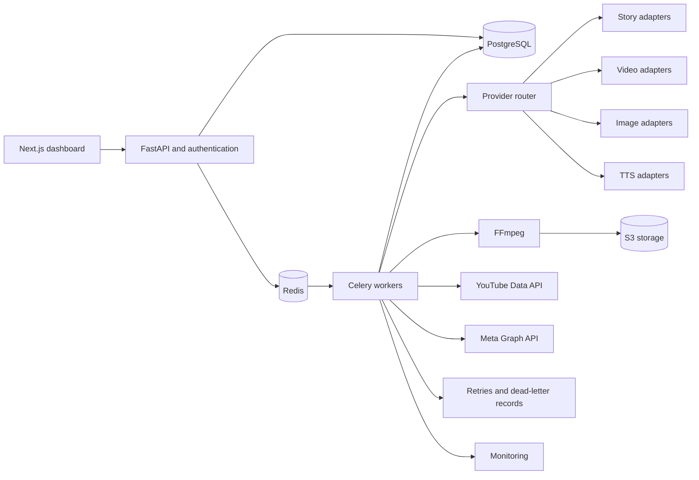
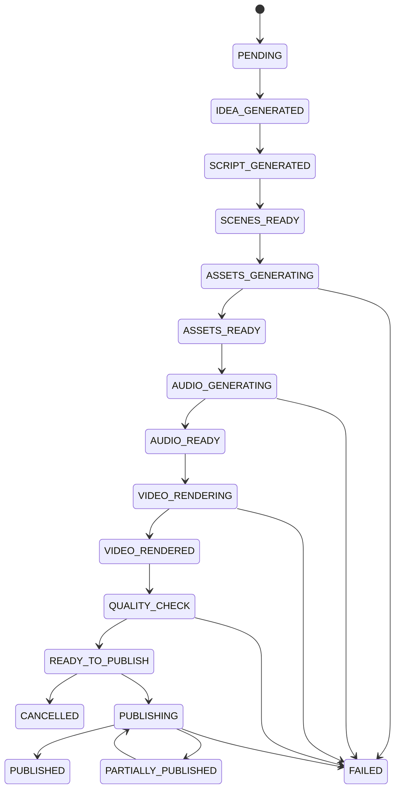

# Platform implementation checklist

- [x] Preserve existing local demo, render and publishing CLI.
- [x] Story routing from config, strict scene schema, environment keys, estimated request budget and fallback tests.
- [x] Local FastAPI dashboard, SQLite job queue, separate worker and preview.
- [x] Independent approval-based delivery queues, with partial failure tests.
- [ ] Extend category adapters and routing to video, image and TTS.
- [ ] Add PostgreSQL schema, encrypted credential management, API authentication and provider settings.
- [ ] Add Redis/Celery workers, persistent orchestration, reconciliation and S3 asset storage.
- [ ] Add Next.js dashboard, provider controls, monitoring and approval workflow.
- [ ] Extend media production and official social integrations.
- [ ] Run infrastructure, live provider and publishing acceptance tests.

## Target architecture

## Target state transitions

## Story provider setup

Install requirements, copy input/story-providers.example.json to input/story-providers.json,
and set STORY_PROVIDER_CONFIG=input/story-providers.json in the local .env. Keep keys in
server-side environment variables. Only configure endpoints you trust with submitted stories.
Enter actual model IDs and conservative estimated per-request costs for your account. The cap
applies to one story invocation and includes attempted calls. It is not a vendor billing ledger.

The current router supports Chat Completions endpoints with JSON object mode, including
compatible model configurations for OpenAI, Gemini, DeepSeek and custom gateways.
Check protocol and model support before enabling an endpoint.

- [OpenAI Chat Completions](https://developers.openai.com/api/reference/resources/chat/subresources/completions/methods/create)
- [Gemini OpenAI compatibility](https://ai.google.dev/gemini-api/docs/openai)
- [DeepSeek JSON output](https://api-docs.deepseek.com/guides/json_mode)

## Video provider selection

Set VIDEO_PROVIDER to muse-video.com or runway. The old MUSE_PROVIDER setting
continues to work as a default. Runway uses Gen-4.5 with a 720p vertical source,
audio disabled, and 4–10 second scenes in the current brief schema. Set
RUNWAY_API_KEY in the local environment. Export resolution remains independent.
A paid Runway submission is journaled before the request. A known task ID can
be polled again. A submission with an unknown outcome requires reconciliation.

- [Runway API reference](https://docs.dev.runwayml.com/api/)
